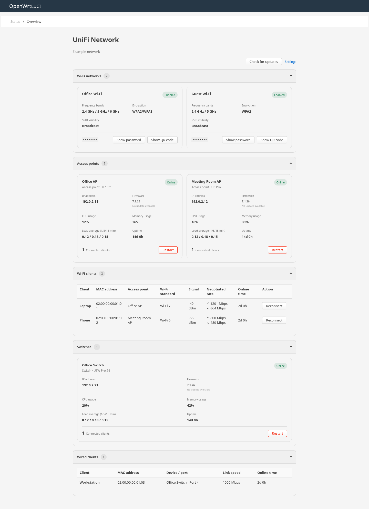

# LuCI UniFi Network

[简体中文](README.zh-CN.md) | English

A LuCI dashboard for monitoring and managing a UniFi Network installation from OpenWrt.



The screenshot uses example data and the plugin's actual dashboard renderer.

## Features

- View Wi-Fi networks, access points, switches, other devices, and wired and wireless clients in **Status → Overview**.
- Inspect device status, firmware, resource usage, client signal, connection rates, and uptime when the controller supplies those details.
- Restart devices, reconnect Wi-Fi clients, check for firmware updates, and upgrade eligible devices. These operations require appropriate permissions and can interrupt connectivity.
- Reveal Wi-Fi passwords on demand and generate Wi-Fi QR codes locally on the router.
- Select a site, configure an optional TLS SNI hostname, and use LuCI's refresh controls and access permissions.

## Requirements

- OpenWrt or a compatible distribution with LuCI and a reachable UniFi Network controller.
- A controller API key with the permissions required for the operations you use.
- The package dependencies: `luci-base`, `luci-mod-status`, `curl`, `jq`, and `qrencode`.

The plugin uses both the UniFi Network Integration API and legacy Network API endpoints. Controller versions and API key permissions can affect available data and actions. See [API research](docs/analysis.md) and [validation results](docs/validation.md) for the observed compatibility and remaining verification limits.

## Installation

Build the package using an OpenWrt SDK or buildroot matching your firmware. Place this repository at `package/luci-app-unifi-network`, select **LuCI → Applications → luci-app-unifi-network** in `make menuconfig`, and run:

```sh
make package/luci-app-unifi-network/compile V=s
```

Install the resulting `luci-app-unifi-network` package using your firmware's package manager. The optional Simplified Chinese package is `luci-i18n-unifi-network-zh-cn`; install it separately.

When replacing the older `luci-app-unifi`, uninstall that application and `luci-i18n-unifi-zh-cn` first, while retaining `/etc/config/unifi`.

## Configuration

1. Open **Services → UniFi Network** and enter the controller HTTPS URL and API key. The default URL is `https://127.0.0.1:11443`.
2. Save and apply the settings, then select a site. If no site is selected, the first site is used.
3. Open **Status → Overview** to view the UniFi Network section. The section also links to the settings page.

The API key is stored in `/etc/config/unifi` on the router. Use a key limited to the permissions you need and rotate it if exposed. LuCI read access permits status viewing; settings, Wi-Fi secrets, and management operations require separate LuCI management access as well as the necessary controller permissions.

### TLS

Certificate verification is enabled by default. If connecting by IP while the certificate or reverse proxy expects a hostname, set **SNI hostname** to that hostname without a scheme, port, or path. The connection still uses the configured address, while SNI, certificate hostname verification, and HTTP Host use the supplied hostname. For IPv6 addresses, use brackets, for example `https://[fd00::1]:11443`.

If the controller certificate is not trusted by OpenWrt, verify its SHA-256 public key fingerprint through a trusted channel and configure the `sha256//...=` pin before disabling certificate verification. Requests are rejected when verification is disabled without a pin, including with older `verify_tls=0` configurations. Update the pin when the certificate's public key changes. Pinning does not provide all the checks of normal certificate verification.

Use HTTPS for LuCI itself: the controller TLS settings protect the router-to-controller connection, not the browser-to-router session.

## Usage

The overview follows LuCI's global refresh interval. Sections can be collapsed independently and retain their state across refreshes and page reloads. Device and client lists are fetched in pages of 200.

Wi-Fi passwords are fetched only when requested; QR codes are generated locally only when opened. A QR code contains the SSID and password, so display it only on trusted devices. Firmware upgrades are offered only for online devices reported as updatable, and the device is checked again before an upgrade. Reconnection and upgrade actions require confirmation.

## Development

The tests in `tests/` cover dashboard Wi-Fi security handling and supplementary status processing. Run them with Node.js:

```sh
node --test tests/*.test.js
```
