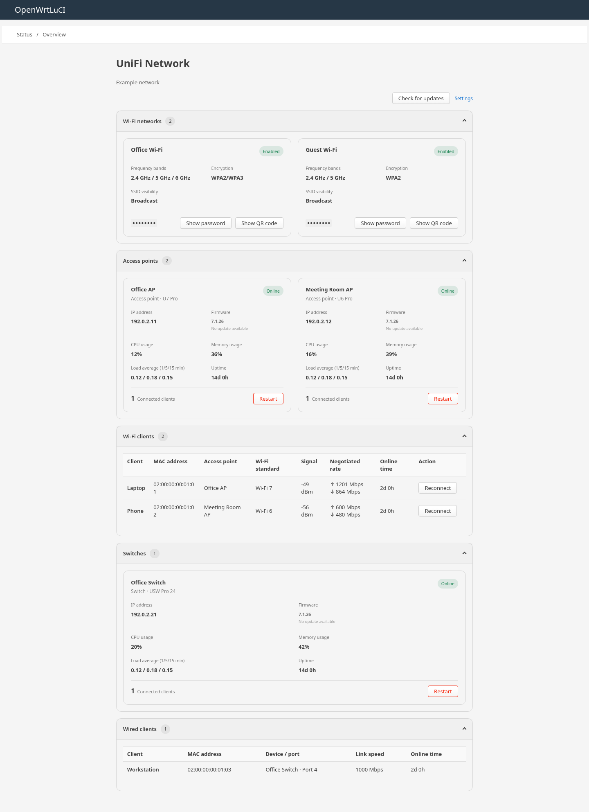

# LuCI UniFi Network

简体中文 | [English](README.md)

在 OpenWrt 上通过 LuCI 监控和管理 UniFi Network 的仪表板。



截图使用示例数据，并由插件实际的仪表板代码渲染。

## 功能

- 在「状态 → 概览」查看 Wi-Fi 网络、接入点、交换机、其他设备以及有线和无线客户端。
- 在控制器提供相应数据时查看设备状态、固件、资源使用情况，以及客户端信号、连接速率和在线时间。
- 重启设备、重新连接 Wi-Fi 客户端、检查固件更新并升级符合条件的设备。这些操作需要相应权限，并可能中断连接。
- 按需显示 Wi-Fi 密码，并在路由器本地生成 Wi-Fi 二维码。
- 选择站点、配置可选的 TLS SNI 域名，并使用 LuCI 的刷新控制和访问权限。

## 环境要求

- 安装了 LuCI、且能够访问 UniFi Network 控制器的 OpenWrt 或兼容发行版。
- 具有所需操作权限的控制器 API Key。
- 软件包依赖：`luci-base`、`luci-mod-status`、`curl`、`jq` 和 `qrencode`。

插件同时使用 UniFi Network Integration API 和旧版 Network API 接口。控制器版本和 API Key 权限可能影响可用数据和操作。已观察到的兼容性和尚未完成的验证范围见 [API 分析](docs/analysis.md)和[验证结果](docs/validation.md)。

## 安装

使用与固件匹配的 OpenWrt SDK 或 buildroot 构建软件包。将本仓库放在 `package/luci-app-unifi-network`，在 `make menuconfig` 中选择 **LuCI → Applications → luci-app-unifi-network**，然后运行：

```sh
make package/luci-app-unifi-network/compile V=s
```

使用固件的软件包管理器安装生成的 `luci-app-unifi-network` 软件包。简体中文语言包 `luci-i18n-unifi-network-zh-cn` 为可选项，需要单独安装。

从旧版 `luci-app-unifi` 迁移时，请先卸载旧应用和 `luci-i18n-unifi-zh-cn`，同时保留 `/etc/config/unifi`。

## 配置

1. 打开「服务 → UniFi Network」，填写控制器 HTTPS 地址和 API Key。默认地址为 `https://127.0.0.1:11443`。
2. 保存并应用设置，然后选择站点。未选择站点时使用第一个站点。
3. 打开「状态 → 概览」查看 UniFi Network 区块。区块中也提供设置页面链接。

API Key 保存在路由器的 `/etc/config/unifi` 中。请将其权限限制在实际需要的范围内，泄露后及时轮换。LuCI 只读权限允许查看状态；设置、Wi-Fi 密码和管理操作还需要独立的 LuCI 管理权限及相应的控制器权限。

### TLS

证书验证默认开启。如果通过 IP 连接，但证书或反向代理要求使用域名，可将「SNI 域名」设置为该域名，不包含协议、端口或路径。连接仍使用配置的地址，而 SNI、证书域名验证和 HTTP Host 使用指定域名。IPv6 地址请使用方括号，例如 `https://[fd00::1]:11443`。

如果控制器证书不受 OpenWrt 信任，请通过可信渠道核对证书的 SHA-256 公钥指纹，并在关闭证书验证前配置 `sha256//...=` 格式的指纹。关闭验证而未配置指纹时请求会被拒绝，旧的 `verify_tls=0` 配置也不例外。证书公钥变更后需要更新指纹。公钥固定不能提供正常证书验证的所有检查。

LuCI 本身也应使用 HTTPS：控制器 TLS 设置保护的是路由器到控制器的连接，不保护浏览器到路由器的会话。

## 使用

概览区块跟随 LuCI 的全局刷新频率。各板块可独立折叠，并在刷新和重新加载页面后保留状态。设备和客户端列表按每页 200 条获取。

Wi-Fi 密码仅在请求时获取；二维码仅在打开时于本地生成。二维码包含 SSID 和密码，请只在可信设备上展示。仅对在线且报告有可用更新的设备提供固件升级，升级前会再次检查设备状态。重新连接和升级操作需要确认。

## 开发

`tests/` 中的测试覆盖仪表板的 Wi-Fi 安全配置处理和补充状态数据处理。使用 Node.js 运行：

```sh
node --test tests/*.test.js
```
